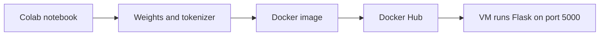

# Service line classifier

Flask app that assigns a support ticket to one of 19 service lines. The form takes a subject and a mail body. A fine-tuned DistilBERT model classifies the concatenated text and returns the line and its probability.

## Request path


The page posts both fields to `POST /predict`. `app.py` joins them with a space, tokenizes with the local DistilBERT tokenizer, runs the model on CPU, and takes the class with the highest softmax probability.

Service lines, in label order: ABAP, BC, CFIN, CMA, CON, EWM, FIN, MAC, MDM, MET, MNF, O2C, P2P, PMN, RE, REP, RSP, SL, TM.

## Training

`train_distillbert.ipynb` fine-tunes `distilbert-base-multilingual-cased`.

- Text is `text_col1` plus `text_col2`. The label column is `service_line`.
- Split is random 80/20, `random_state=42`. There is no separate test set in the notebook.
- Sequence length 128, batch size 16, AdamW at `2e-5`, dropout 0.06, up to 15 epochs.
- Early stopping watches validation loss with patience 5. The reported metric is weighted F1.
- The notebook runs in Colab and reads `/content/df_colab.xlsx`. The spreadsheet is not in this repo.

The running app does not train. It loads `trained_distilbert_pytorch.pt` and `local_model_assets_multi/` (config and tokenizer). Those files are not in git. The Dockerfile copies them in at build time.

## Deploy



Published image:

```bash
docker pull livinmax/distilbert-app:fin
```

## Layout

```
app.py
Dockerfile
requirements.txt
templates/index.html
train_distillbert.ipynb
```
